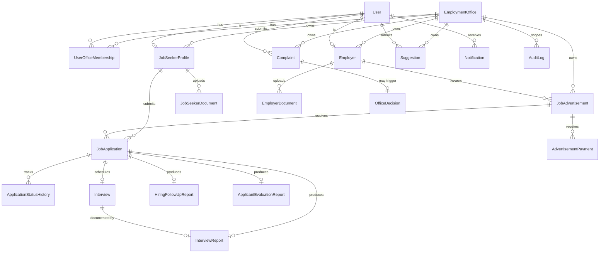

# Database Documentation — Church Employment Office Platform

**Status:** Draft for product-owner / tech-lead review
**Depends on:** [BUSINESS_REQUIREMENTS.md](./BUSINESS_REQUIREMENTS.md) §15–§16, §23
**Conventions from:** [BACKEND_GUIDELINES.md](./BACKEND_GUIDELINES.md) §6–§7
**Companion:** [RBAC_PERMISSIONS.md](./RBAC_PERMISSIONS.md), [WORKFLOWS_AND_STATE_MACHINES.md](./WORKFLOWS_AND_STATE_MACHINES.md)

> This is a **conceptual + logical schema**, not yet a migration. Before coding, confirm the open
> items in §8 and run this past whatever already exists in the repository (BUSINESS_REQUIREMENTS.md
> §21, Phase 0 — "do not create duplicate entities if equivalent models already exist").

---

## 1. Conventions used throughout this schema

Taken from BACKEND_GUIDELINES.md §6:

- **Keys:** `uniqueidentifier` (`Guid`) everywhere, generated application-side before insert.
- **`IEntity` columns on every business table:** `Id`, `CreatedBy` (nullable `Guid`, FK → `Users.Id`),
  `CreationDate` (`datetime2`, UTC), `ModifiedBy` (nullable), `ModifiedDate` (nullable),
  `IsActive` (`bit`, default `1`). Stamped centrally by `AuditStampingInterceptor` — never written
  by hand. Omitted from the per-table column lists below to avoid repeating it 20 times; assume
  every table in §3–§6 has it unless stated otherwise.
- **Soft delete by default.** `IsActive = 0` hides a row from normal queries; hard delete is
  reserved for rows that were never a business fact (see §7.4). This directly implements
  BUSINESS_REQUIREMENTS.md's repeated "do not delete, preserve history" rule (§5.1, §11.3, §11.4,
  §12.5, §16).
- **Money:** `decimal(18,2)`, never `float`/`double`.
- **Dates:** `datetime2`, stored UTC.
- **Strings:** explicit `nvarchar(n)` with a stated max length; no unbounded `nvarchar(max)`
  except free-text fields explicitly called out as such (complaint text, report notes).
- **Bilingual fields:** the platform is **confirmed Arabic-only** (RBAC_PERMISSIONS.md §0 item 22),
  so the `Name` + `ArName` pattern (BACKEND_GUIDELINES §5) is used sparingly — only on
  `EmploymentOffice` (§3), where an English back-office label is still plausible. Lookup tables and
  `JobAdvertisement` category labels (§7.1) hold the Arabic value directly in `Name`, no `ArName`.
- **Foreign keys default to `ON DELETE RESTRICT`.** A tenant/parent row is never hard-deleted while
  children exist; office/employer/job-seeker deactivation is a status flag, not a `DELETE`.
- **Every tenant-owned table carries `OfficeId`** (BUSINESS_REQUIREMENTS.md §12.1) and is indexed on
  it first.

---

## 2. Entity-relationship diagram

Grouped diagrams for each lifecycle (registration, advertisement, application/reports, complaints)
live in [WORKFLOWS_AND_STATE_MACHINES.md](./WORKFLOWS_AND_STATE_MACHINES.md) — this ERD shows
structure, not state transitions.

---

## 3. Platform & identity tables

### `EmploymentOffice` (the tenant)

| Column | Type | Null? | Notes |
|---|---|---|---|
| `Name` | nvarchar(200) | No | |
| `ArName` | nvarchar(200) | Yes | |
| `Code` | nvarchar(30) | No | URL-safe slug. **Unique.** |
| `Address` | nvarchar(300) | Yes | |
| `City` | nvarchar(100) | Yes | FK → `City.Id` once lookup table exists (§7.1), free text until then. |
| `Phone` | nvarchar(30) | Yes | |
| `Email` | nvarchar(200) | Yes | |
| `Status` | tinyint (enum `OfficeStatus`) | No | `Active` \| `Inactive`. Default `Active`. |

Indexes: unique on `Code`. No `OfficeId` column — this *is* the tenant root.

### `Users` (Identity — `ApplicationUser`)

Extends `IdentityUser<Guid>`. Platform-wide table, **not** tenant-scoped (a row's tenant is derived
through `UserOfficeMembership`, or through the `OfficeId` on the `JobSeekerProfile`/`Employer` row
it owns).

| Column | Type | Null? | Notes |
|---|---|---|---|
| `PhoneNumber` / `NormalizedPhoneNumber` | nvarchar(30) | No | **Confirmed login identifier** (RBAC_PERMISSIONS.md §0 item 10). **Unique.** |
| `PhoneNumberConfirmed` | bit | No | Set `true` only after a successful OTP verification (see `OtpVerification` below) — registration cannot complete while `false`. |
| `UserName` / `NormalizedUserName` | Identity default | | Mirrors `PhoneNumber` for Identity-internals compatibility; not shown to the user. |
| `Email` / `NormalizedEmail` | Identity default | Yes | Optional, never used for login. |
| `PasswordHash` | Identity default | | Never plain text (BUSINESS_REQUIREMENTS.md §15.1). |
| `FullName` | nvarchar(200) | No | Display name shown in office/admin UIs. |
| `IsSuperAdmin` | bit | No | Platform-level flag, orthogonal to office membership. Default `0`. |
| `AccountStatus` | tinyint (enum `AccountStatus`) | No | `Active` \| `Locked` \| `Deactivated`. Checked on every token validation (BACKEND_GUIDELINES §12, "re-check the account on every request"). |

### `OtpVerification`

**Confirmed (RBAC_PERMISSIONS.md §0 item 10):** registration requires OTP verification of the
phone number. A short-lived, single-purpose code table — not part of `Users` itself, so a failed/
expired attempt never pollutes the identity row.

| Column | Type | Null? | Notes |
|---|---|---|---|
| `PhoneNumber` | nvarchar(30) | No | Target of the code — the user row may not exist yet at send time (pre-registration). |
| `CodeHash` | nvarchar(200) | No | Hashed, never the raw code. |
| `Purpose` | tinyint (enum `OtpPurpose`) | No | `Registration` \| `PasswordReset`. |
| `ExpiresAt` | datetime2 | No | Short TTL (minutes, not hours). |
| `ConsumedAt` | datetime2 | Yes | Set once used — a code is single-use. |
| `AttemptCount` | tinyint | No | Rate-limit guard; lock out after a configured max. |

Indexes: `(PhoneNumber, Purpose, ExpiresAt)`. Purge consumed/expired rows on a schedule — this is
the one table explicitly exempt from the platform's "retain everything" rule (§8), since an OTP
code is not a business record.

### `UserOfficeMembership`

**Confirmed (RBAC_PERMISSIONS.md §0 item 4):** exactly one office per account.

| Column | Type | Null? | Notes |
|---|---|---|---|
| `UserId` | Guid FK → `Users.Id` | No | |
| `OfficeId` | Guid FK → `EmploymentOffice.Id` | No | |
| `Role` | tinyint (enum `OfficeRole`) | No | `OfficeAdmin` \| `OfficeStaff`. |
| `MembershipStatus` | tinyint (enum `MembershipStatus`) | No | `Active` \| `Invited` \| `Revoked`. |

Indexes: unique on `(UserId, OfficeId)` — one membership row per user per office, enforcing "one
office per account" at the data level by only ever writing one *active* row per user at launch,
without hard-blocking a second office later.

### `StaffPermissionGrant`

Implements the data-driven `OfficeStaff` permission subset from RBAC_PERMISSIONS.md §1/§7.

| Column | Type | Null? | Notes |
|---|---|---|---|
| `UserOfficeMembershipId` | Guid FK → `UserOfficeMembership.Id` | No | |
| `PermissionCode` | nvarchar(60) | No | e.g. `jobseekers.approve`. Validated against the seeded `PermissionDefinition` catalogue, not a free string. |

Indexes: unique on `(UserOfficeMembershipId, PermissionCode)`.

### `PermissionDefinition` (seeded reference data, not user-editable)

| Column | Type | Null? | Notes |
|---|---|---|---|
| `Code` | nvarchar(60) | No | **PK.** `module.action`, matches RBAC_PERMISSIONS.md §2. |
| `Module` | nvarchar(40) | No | |
| `Action` | nvarchar(20) | No | |
| `Description` | nvarchar(300) | Yes | Shown on the staff-permission-assignment screen. |

---

## 4. Job Seeker domain

### `JobSeekerProfile`

| Column | Type | Null? | Notes |
|---|---|---|---|
| `OfficeId` | Guid FK → `EmploymentOffice.Id` | No | Tenant key. Indexed. |
| `UserId` | Guid FK → `Users.Id` | No | **Unique** (one profile per user at launch). |
| `FullName` | nvarchar(200) | No | |
| `MobileNumber` | nvarchar(30) | No | |
| `Email` | nvarchar(200) | Yes | Mandatory-field list pending §8.1. |
| `Address` | nvarchar(300) | Yes | |
| `City` | nvarchar(100) | Yes | |
| `DateOfBirth` | date | Yes | |
| `Education` | nvarchar(200) | Yes | |
| `YearsOfExperience` | tinyint | Yes | |
| `Skills` | nvarchar(1000) | Yes | Free text at launch; consider a tag table if search-by-skill is needed later. |
| `CareerSummary` | nvarchar(2000) | Yes | |
| `PreferredJobCategoryId` | Guid FK → `JobCategory.Id` | Yes | See §7.1. |
| `ReviewStatus` | tinyint (enum `JobSeekerReviewStatus`) | No | See WORKFLOWS_AND_STATE_MACHINES.md §1. |
| `ApprovedBy` | Guid FK → `Users.Id` | Yes | |
| `ApprovedAt` | datetime2 | Yes | |
| `RejectionReason` | nvarchar(500) | Yes | |
| `SuspendedAt` | datetime2 | Yes | |
| `SuspensionReason` | nvarchar(500) | Yes | |

Indexes: `(OfficeId, ReviewStatus)` for review queues; unique `UserId`.

**Confirmed (RBAC_PERMISSIONS.md §0 item 11):** editing any field on an `Approved` profile, or
re-uploading any `JobSeekerDocument`, automatically reverts `ReviewStatus` to `UnderReview` — this
is a service-layer side effect of the update, not a client choice.

### `JobSeekerDocument`

| Column | Type | Null? | Notes |
|---|---|---|---|
| `OfficeId` | Guid FK | No | Denormalized from `JobSeekerProfile` for isolation-filter simplicity. |
| `JobSeekerId` | Guid FK → `JobSeekerProfile.Id` | No | |
| `DocumentType` | tinyint (enum `JobSeekerDocumentType`) | No | `RecommendationLetter` \| `NationalId` \| `Cv` (BUSINESS_REQUIREMENTS.md §5.1 Step 4). |
| `SecureFileReference` | nvarchar(500) | No | Opaque storage key, never a public URL (BUSINESS_REQUIREMENTS.md §17.3). |
| `OriginalFileName` | nvarchar(260) | No | |
| `MimeType` | nvarchar(100) | No | Validated server-side, not trusted from the extension. |
| `FileSizeBytes` | int | No | Checked against a configured max (§8.1). |
| `ReviewStatus` | tinyint (enum `DocumentReviewStatus`) | No | `Pending` \| `Approved` \| `Rejected`. |
| `ReviewedBy` | Guid FK → `Users.Id` | Yes | |
| `ReviewedAt` | datetime2 | Yes | |
| `RejectionReason` | nvarchar(500) | Yes | |
| `UploadedAt` | datetime2 | No | |

Indexes: `(JobSeekerId, DocumentType)` — consider **unique** per `(JobSeekerId, DocumentType)` if
only the latest upload of each required document type should be kept active; otherwise keep
history and let `IsActive` mark the current one. **Recommend: keep history**, matching
BUSINESS_REQUIREMENTS.md's general "preserve history" stance — the current/active document is the
most recent row with `IsActive = 1`.

---

## 5. Employer & job advertisement domain

### `Employer`

| Column | Type | Null? | Notes |
|---|---|---|---|
| `OfficeId` | Guid FK | No | |
| `UserId` | Guid FK → `Users.Id` | No | **Unique** (one representative user per company at launch). |
| `LegalName` | nvarchar(250) | No | |
| `DisplayName` | nvarchar(250) | No | Shown publicly on job listings (never contact info — BUSINESS_REQUIREMENTS.md §6.2). |
| `BusinessActivity` | nvarchar(200) | Yes | |
| `Address` | nvarchar(300) | Yes | |
| `City` | nvarchar(100) | Yes | |
| `CompanyEmail` | nvarchar(200) | Yes | **Private** — never serialized into a public job DTO. |
| `CompanyPhone` | nvarchar(30) | Yes | **Private** — same. |
| `RepresentativeName` | nvarchar(200) | Yes | |
| `RepresentativeRole` | nvarchar(100) | Yes | |
| `VerificationStatus` | tinyint (enum `EmployerVerificationStatus`) | No | See WORKFLOWS_AND_STATE_MACHINES.md §3. |
| `ApprovedBy` / `ApprovedAt` / `RejectionReason` | — | Yes | Same pattern as `JobSeekerProfile`. |
| `CooperationStatus` | tinyint (enum `EmployerCooperationStatus`) | No | `Active` \| `Stopped`. **Separate field from `VerificationStatus`** — stopping cooperation (§11.4) is a distinct state domain from the initial approval, per BUSINESS_REQUIREMENTS.md §23. |

**Confirmed (RBAC_PERMISSIONS.md §0 item 11):** same auto-revert-to-`UnderReview` rule as
`JobSeekerProfile` — any edit to the company profile or any re-uploaded `EmployerDocument` flips an
`Approved` `VerificationStatus` back to `UnderReview`.

### `EmployerDocument`

Same shape as `JobSeekerDocument`, with `DocumentType` enum `CommercialRegister` \| `TaxCard` \|
`OwnerNationalId` (BUSINESS_REQUIREMENTS.md §5.2) and `EmployerId` instead of `JobSeekerId`.

### `JobAdvertisement`

| Column | Type | Null? | Notes |
|---|---|---|---|
| `OfficeId` | Guid FK | No | |
| `EmployerId` | Guid FK → `Employer.Id` | No | |
| `Title` | nvarchar(200) | No | |
| `Description` | nvarchar(4000) | Yes | Confirm mandatory fields per §8.3. |
| `ExperienceRequirement` | nvarchar(200) | Yes | |
| `WorkingHours` | nvarchar(100) | Yes | |
| `Address` | nvarchar(300) | Yes | |
| `CategoryId` | Guid FK → `JobCategory.Id` | Yes | See §7.1. |
| `City` | nvarchar(100) | Yes | Candidate for a `CityId` FK once §7.1 lands. |
| `EmploymentType` | tinyint (enum `EmploymentType`) | Yes | FullTime \| PartTime \| Contract — field itself unconfirmed (§8.3). |
| `SalaryMin` / `SalaryMax` | decimal(18,2) | Yes | Optional per §8.3. |
| `VacancyCount` | int | Yes | Default 1. |
| `Status` | tinyint (enum `JobAdvertisementStatus`) | No | See WORKFLOWS_AND_STATE_MACHINES.md §5. |
| `SubmittedAt` | datetime2 | Yes | |
| `ApprovedBy` / `ApprovedAt` / `RejectionReason` | — | Yes | |
| `PublishedAt` | datetime2 | Yes | **Confirmed anchor for the 15-day expiry clock** (RBAC_PERMISSIONS.md §0 item 15 — publish time, not payment time). |
| `ExpiresAt` | datetime2 | Yes | Computed = `PublishedAt + 15 days` at publish time; stored (not computed on read) so a background job can query "due to expire" directly. |
| `ClosedAt` | datetime2 | Yes | |

Indexes: `(OfficeId, Status, ExpiresAt)` — the hot path for "active public search" and for the
expiry background job. `(EmployerId, Status)` for the employer's own advertisement list.

**Confirmed (RBAC_PERMISSIONS.md §0 item 16):** an Employer editing a `Published` advertisement
moves it back to `UnderReview` — `ExpiresAt`/`PublishedAt` are **not** reset by this, only a
content/approval re-check happens. **Confirmed (§0 item 17):** renewing an `Expired` advertisement
always creates a brand-new row (optionally via a `RenewedFromAdvertisementId` self-FK pre-filling
the form) with its own new `AdvertisementPayment` — never an update to the expired row.

### `AdvertisementPayment`

| Column | Type | Null? | Notes |
|---|---|---|---|
| `OfficeId` | Guid FK | No | |
| `EmployerId` | Guid FK → `Employer.Id` | No | |
| `JobAdvertisementId` | Guid FK → `JobAdvertisement.Id` | No | |
| `Amount` | decimal(18,2) | No | Fee amount — exact figure still TBD with the product owner; currency is fixed (next row). |
| `Currency` | nvarchar(3) | No | **Confirmed: `EGP`** (RBAC_PERMISSIONS.md §0 item 18). Kept as a column rather than a hard-coded constant so a future office/region can override it. |
| `PaymentStatus` | tinyint (enum `PaymentStatus`) | No | `Pending` \| `Paid` \| `Failed` \| `Refunded`. `Refunded` is modeled but **confirmed unused in v1** — no refund policy (§0 item 20). |
| `PaymentMethod` | nvarchar(50) | No | **Confirmed: `Manual` only for v1** (§0 item 18) — office staff confirm payment themselves. Kept as a string (not a fixed enum) specifically so a payment-gateway method can be added later without a migration. |
| `TransactionReference` | nvarchar(200) | Yes | Unused while `PaymentMethod == Manual`; reserved for a future gateway reference. |
| `PaidAt` | datetime2 | Yes | **This is the field `applicantdata.viewgated` (RBAC_PERMISSIONS.md §5) checks against.** |
| `RecordedBy` | Guid FK → `Users.Id` | No | The office staff member who manually confirmed the payment (`advertisementpayments.record`) — mandatory in v1 since there is no gateway webhook to attribute it to instead. |

Indexes: `(JobAdvertisementId, PaymentStatus)`. One `Paid` row per advertisement is the expected
shape — confirmed, since renewal always creates a new advertisement (and thus a new payment row)
rather than a second payment against the same ad.

---

## 6. Application, interview & report domain

### `JobApplication`

| Column | Type | Null? | Notes |
|---|---|---|---|
| `OfficeId` | Guid FK | No | |
| `JobAdvertisementId` | Guid FK → `JobAdvertisement.Id` | No | |
| `JobSeekerId` | Guid FK → `JobSeekerProfile.Id` | No | |
| `EmployerFacingStatus` | tinyint (enum `EmployerApplicationOutcome`) | No | `ContactedInterviewScheduled` \| `ContactedRefused` \| `NoResponseAfterContact`, default a "not yet contacted" value. |
| `JobSeekerFacingStatus` | tinyint (enum `JobSeekerApplicationStatus`) | No | `NotContacted` \| `ContactedNotSuitable` \| `ContactedInterviewScheduled`. **Deliberately a second column, not derived from `EmployerFacingStatus` by a lookup table** — BUSINESS_REQUIREMENTS.md §8 explicitly warns these two status sets are not the same thing; see WORKFLOWS_AND_STATE_MACHINES.md §7 for the mapping rules that keep them in sync. |
| `AppliedAt` | datetime2 | No | |
| `LastStatusChangedAt` | datetime2 | No | |
| `WithdrawnAt` | datetime2 | Yes | **Confirmed (RBAC_PERMISSIONS.md §0 item 14):** the Job Seeker may withdraw; `WithdrawnAt` marks it terminal. |

Indexes: **a filtered unique index on `(JobAdvertisementId, JobSeekerId) WHERE WithdrawnAt IS
NULL`** — confirmed: a Job Seeker may have at most one *active* (non-withdrawn) application per
advertisement, but may re-apply (a new row) after withdrawing a previous one. A plain unique
constraint without the filter would block that re-application.

### `ApplicationStatusHistory`

| Column | Type | Null? | Notes |
|---|---|---|---|
| `JobApplicationId` | Guid FK | No | |
| `OldStatus` / `NewStatus` | tinyint | No | Same enum as the field being changed — include a `StatusDomain` discriminator (`EmployerFacing` \| `JobSeekerFacing`) since both status columns funnel into one history table. |
| `ChangedBy` | Guid FK → `Users.Id` | No | |
| `ActorRole` | tinyint (enum `OfficeRole`/`Employer`/`JobSeeker`) | No | |
| `Notes` | nvarchar(1000) | Yes | |
| `ChangedAt` | datetime2 | No | |

### `Interview`

| Column | Type | Null? | Notes |
|---|---|---|---|
| `OfficeId` | Guid FK | No | |
| `JobApplicationId` | Guid FK | No | |
| `ScheduledAt` | datetime2 | Yes | |
| `LocationOrMeetingDetails` | nvarchar(500) | Yes | |
| `Status` | tinyint (enum `InterviewStatus`) | No | `Scheduled` \| `Completed` \| `Cancelled` \| `NoShow`. |
| `CreatedBy` covered by `IEntity`. | | | **Confirmed (§0 item 21): the Employer** schedules and records it, directly, since contact is direct post-payment. |

### `InterviewReport` (first report, BUSINESS_REQUIREMENTS.md §10.1)

**Confirmed (§0 item 21): written by the Employer.**

| Column | Type | Null? | Notes |
|---|---|---|---|
| `OfficeId` | Guid FK | No | |
| `JobApplicationId` | Guid FK | No | |
| `InterviewId` | Guid FK → `Interview.Id` | Yes | |
| `Attendance` | tinyint (enum `AttendanceResult`) | No | `Attended` \| `DidNotAttend`. |
| `InterviewResult` | nvarchar(100) | Yes | Exact field set still TBD with the product owner (field list only — authorship is confirmed). |
| `EmployerEvaluation` | nvarchar(2000) | Yes | |
| `Strengths` / `Concerns` / `Recommendation` | nvarchar(1000) each | Yes | |
| `Notes` | nvarchar(2000) | Yes | |

### `HiringFollowUpReport` (second report, one month after hiring, BUSINESS_REQUIREMENTS.md §10.2)

**Confirmed (§0 item 21): written by the office**, who follows up with both the Employer and the
Job Seeker — not a self-service form either side fills in directly. **Mandatory for every hire**;
an unfiled report past `DueAt` becomes `Overdue` and notifies the responsible staff (no harder
enforcement than that notification is confirmed).

| Column | Type | Null? | Notes |
|---|---|---|---|
| `OfficeId` | Guid FK | No | |
| `JobApplicationId` | Guid FK | No | |
| `HiredAt` | datetime2 | No | Anchor for `DueAt`. |
| `DueAt` | datetime2 | No | = `HiredAt + 1 month`, computed at creation. |
| `Status` | tinyint (enum `FollowUpReportStatus`) | No | `PendingDue` \| `Completed` \| `Overdue`. |
| `StillEmployed` / `EmployerSatisfied` / `JobSeekerSatisfied` | bit | Yes | Exact field set still TBD with the product owner (field list only — authorship/mandatoriness are confirmed). |
| `Notes` | nvarchar(2000) | Yes | |
| `CompletedAt` | datetime2 | Yes | |
| `CompletedBy` | Guid FK → `Users.Id` | Yes | Office staff member who closed it out. |

### `ApplicantEvaluationReport` (per-applicant employer outcome, §9/§10.3)

| Column | Type | Null? | Notes |
|---|---|---|---|
| `OfficeId` | Guid FK | No | |
| `JobApplicationId` | Guid FK | No | **Unique** — one evaluation per application (re-evaluation = update, not a new row; keep history via audit log if needed). |
| `EmployerId` | Guid FK | No | Denormalized for query convenience. |
| `Outcome` | tinyint (enum `ApplicantEvaluationOutcome`) | No | `Suitable` \| `NotSuitable` \| `DidNotAttend` \| `RefusedJob`. |
| `Notes` | nvarchar(2000) | Yes | |
| `SubmittedBy` | Guid FK → `Users.Id` | No | |
| `SubmittedAt` | datetime2 | No | |

---

## 7. Complaints, suggestions & cross-cutting tables

### `Complaint`

| Column | Type | Null? | Notes |
|---|---|---|---|
| `OfficeId` | Guid FK | No | |
| `SubmittedByUserId` | Guid FK → `Users.Id` | No | |
| `SenderType` | tinyint (enum `ComplaintSenderType`) | No | `JobSeeker` \| `Employer`. |
| `SubjectType` | tinyint (enum `ComplaintSubjectType`) | No | `JobSeeker` \| `Employer` \| `JobAdvertisement` \| `Other` — final list pending §8.7. |
| `SubjectId` | Guid | Yes | Polymorphic reference, resolved via `SubjectType`. No DB-level FK (can't FK a polymorphic column) — **enforce the reference in the service layer**, not the database. |
| `ComplaintText` | nvarchar(4000) | No | |
| `Status` | tinyint (enum `ComplaintStatus`) | No | `New` \| `UnderReview` \| `WaitingForInformation` \| `Resolved` \| `Rejected` \| `Closed`. |
| `ValidityDecision` | tinyint (enum `ComplaintValidity`) | No | `Pending` \| `Valid` \| `Invalid`. **This is the field the 3-strike counter in WORKFLOWS_AND_STATE_MACHINES.md §10.3 filters on** (confirmed, RBAC_PERMISSIONS.md §0 item 5). |
| `AssignedTo` | Guid FK → `Users.Id` | Yes | |
| `Resolution` | nvarchar(2000) | Yes | |
| `ReviewedBy` / `ReviewedAt` | — | Yes | |

Indexes: `(OfficeId, SubjectType, SubjectId, ValidityDecision)` — the exact index the 3-strike
calculation runs against.

### `Suggestion`

| Column | Type | Null? | Notes |
|---|---|---|---|
| `OfficeId` | Guid FK | No | |
| `SubmittedByUserId` | Guid FK → `Users.Id` | No | Anonymous submission is **not supported** per the current read of §11.1 — revisit if confirmed otherwise. |
| `SenderType` | tinyint (enum `ComplaintSenderType`) | No | Reuse the same enum as `Complaint.SenderType`. |
| `Content` | nvarchar(4000) | No | |
| `Status` | tinyint (enum `SuggestionStatus`) | No | `New` \| `UnderReview` \| `Responded` \| `Closed`. |
| `OfficeNotes` | nvarchar(2000) | Yes | |

### `OfficeDecision`

Append-only audit of the two enforcement actions BUSINESS_REQUIREMENTS.md requires an explicit
office approval for (§11.3, §11.4).

| Column | Type | Null? | Notes |
|---|---|---|---|
| `OfficeId` | Guid FK | No | |
| `TargetType` | tinyint (enum `OfficeDecisionTargetType`) | No | `JobSeeker` \| `Employer`. |
| `TargetId` | Guid | No | Polymorphic, same caveat as `Complaint.SubjectId`. |
| `DecisionType` | tinyint (enum `OfficeDecisionType`) | No | `Suspend` \| `Reinstate` \| `StopCooperation` \| `ResumeCooperation`. |
| `Reason` | nvarchar(2000) | No | Mandatory — this table exists specifically so a suspension is never silent. |
| `DecidedBy` | Guid FK → `Users.Id` | No | Must hold `complaints.decide` / equivalent (RBAC_PERMISSIONS.md footnote 5). |
| `DecidedAt` | datetime2 | No | |

### `Notification`

| Column | Type | Null? | Notes |
|---|---|---|---|
| `OfficeId` | Guid FK | Yes | Nullable only for a platform-level notification to a Super Admin. |
| `RecipientUserId` | Guid FK → `Users.Id` | No | |
| `EventType` | nvarchar(80) | No | Catalogue in BUSINESS_REQUIREMENTS.md §13 — kept as a string, not an enum, so new event types don't require a migration. |
| `RelatedType` / `RelatedId` | nvarchar(60) / Guid | Yes | Polymorphic pointer to the triggering record. |
| `Message` | nvarchar(1000) | No | |
| `ReadAt` | datetime2 | Yes | |
| `DeliveryStatus` | tinyint (enum `DeliveryStatus`) | Yes | **Confirmed: in-app only for v1** (RBAC_PERMISSIONS.md §0 item 22) — column kept nullable/unused rather than removed, so an SMS/email channel can be added later without a migration. |

Indexes: `(RecipientUserId, ReadAt)` for the unread-count query.

### `AuditLog`

| Column | Type | Null? | Notes |
|---|---|---|---|
| `OfficeId` | Guid FK | Yes | Nullable only for genuinely platform-level events (office creation, Super Admin actions). |
| `ActorUserId` | Guid FK → `Users.Id` | No | |
| `ActorRole` | tinyint | No | |
| `Action` | nvarchar(80) | No | e.g. `JobSeeker.Approve`. |
| `EntityType` / `EntityId` | nvarchar(60) / Guid | No | |
| `BeforeData` / `AfterData` | nvarchar(max) JSON | Yes | **Never** copy document file contents or raw secrets here (BUSINESS_REQUIREMENTS.md §15.1 note). |
| `IpAddress` / `DeviceMetadata` | nvarchar(100) | Yes | Only if legally appropriate for the deployment jurisdiction. |

---

## 7.1 Proposed lookup tables (not in the original entity inventory)

BUSINESS_REQUIREMENTS.md leaves `City` and job `Category` as free-text fields. For a Wuzzuf-style
filter sidebar (UI_UX_GUIDELINES.md §4) to work — exact-match filtering, consistent spelling, a
fixed facet list — these should be lookup tables, not free text. **Flagging as a proposed addition,
not a confirmed requirement:**

### `JobCategory`

| Column | Type | Null? |
|---|---|---|
| `Name` | nvarchar(100) | No |
| `DisplayOrder` | int | No |

### `City`

| Column | Type | Null? |
|---|---|---|
| `Name` | nvarchar(100) | No |
| `Governorate` | nvarchar(100) | Yes |

Since the platform is **confirmed Arabic-only** (RBAC_PERMISSIONS.md §0 item 22), the `ArName`
bilingual-pairing convention from BACKEND_GUIDELINES §5 is **not required** here — `Name` simply
holds the Arabic value directly. Keep the `Name`/`ArName` pattern only on `EmploymentOffice` (§3),
where an English admin-facing label is still plausible even if the public product itself is
Arabic-only; drop it everywhere else unless the product owner later asks for bilingual UI.

If the product owner rejects this proposed addition, keep `JobAdvertisement.City` / `.CategoryId`
as free-text `nvarchar` columns instead and build filters off a `DISTINCT` query — functional, but
facet counts and spelling consistency degrade over time.

---

## 8. Remaining open decisions

Most of the §24 questions that originally drove this section were reviewed and confirmed with the
product owner on 2026-11-18 (see RBAC_PERMISSIONS.md §0 for the full list and this document's
inline **"Confirmed"** notes for where each one lands in the schema). What is genuinely still open
is narrower — field-level detail, not structural decisions:

| § | Question | Schema impact if answered differently |
|---|---|---|
| §24.B.8/B.9 | Exact mandatory fields on `JobSeekerProfile`/`Employer` (which of the "suggested fields" are actually required) | Several `nvarchar`/date columns on those two tables flip between required and optional; no new tables needed either way. |
| §24.C.13/C.14 | Exact mandatory `JobAdvertisement` fields; is `SalaryMin`/`SalaryMax` required or optional | Same — column nullability only, not a structural change. |
| §24.D.22 | Exact fee amount | A config value / seeded reference row, not a schema change — `AdvertisementPayment.Amount` already exists as `decimal(18,2)`. |
| §24.F.41/F.43 | Exact field list on `InterviewReport`/`HiringFollowUpReport` beyond what's modeled here | Additional nullable columns on those two tables; authorship and mandatoriness are already confirmed (§4, §6 above). |
| §24.G.53 | Can a suspended Job Seeker or blocked company appeal, and how? | May need an `AppealedAt`/`AppealOutcome`/`AppealNotes` set of columns on `OfficeDecision`, or a separate `Appeal` table if the office needs a structured review flow for it. Not modeled yet — flag this explicitly if the product owner wants an appeal path before launch. |

A later native mobile app (RBAC_PERMISSIONS.md §0 item 23) has **no schema impact** — this stays a
plain relational schema behind a REST API regardless of which client calls it.

---

## 9. Integrity rules (BUSINESS_REQUIREMENTS.md §16, BACKEND_GUIDELINES §7)

1. A `JobApplication` must reference a `JobSeekerProfile` and `JobAdvertisement` in the **same**
   `OfficeId` — reject at the service layer even though there is no cross-table DB constraint for
   this without a computed/check constraint.
2. `JobAdvertisement.EmployerId` must belong to the same `OfficeId` as the advertisement.
3. Every report (`InterviewReport`, `HiringFollowUpReport`, `ApplicantEvaluationReport`) must
   reference a `JobApplication` in the same `OfficeId`.
4. `OnDelete` is `Restrict` everywhere by default (§1) — the one exception under consideration is
   `ApplicationStatusHistory`/`AuditLog` rows cascading when their *parent* history-owning row is
   hard-deleted, which should never happen under the soft-delete convention anyway.
5. Every FK you filter by in a hot query gets a non-clustered index (§3–§7 call these out
   explicitly); don't rely on the FK alone to be indexed.

---

*Update this document in the same change that adds a migration. If a migration disagrees with this
file, the migration is the bug.*
