# Workflows & State Machines — Church Employment Office Platform

**Status:** Draft for product-owner / tech-lead review
**Depends on:** [BUSINESS_REQUIREMENTS.md](./BUSINESS_REQUIREMENTS.md) §5, §6, §7, §9–§11, §22, §23
**Companion:** [DATABASE_DOCUMENTATION.md](./DATABASE_DOCUMENTATION.md) (enum/column source),
[RBAC_PERMISSIONS.md](./RBAC_PERMISSIONS.md) (who may fire each transition)

> BUSINESS_REQUIREMENTS.md §23 is explicit: **do not collapse unrelated processes into one generic
> `status` field.** Each section below is one independent state machine, matching one column in
> DATABASE_DOCUMENTATION.md. A transition that is not listed in its table must be rejected by the
> service layer, not just hidden by the frontend.

---

## 1. Job Seeker profile review — `JobSeekerProfile.ReviewStatus`

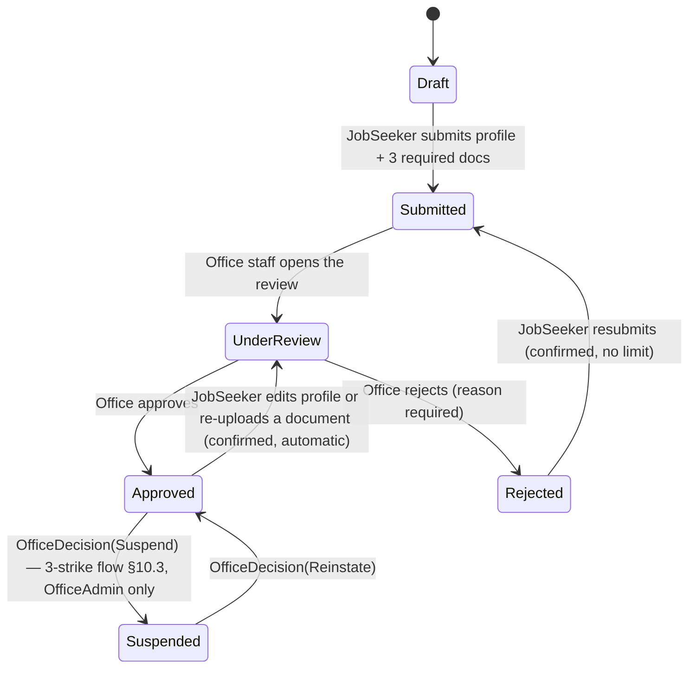

| Transition | Actor / permission | Preconditions | Side effects |
|---|---|---|---|
| `Draft → Submitted` | `JobSeeker` (own profile) | All 3 required documents uploaded (`RecommendationLetter`, `NationalId`, `Cv`) with `DocumentReviewStatus` not yet relevant — just *present* | `Notification` → office review queue; `Notification` → JobSeeker ("submitted") |
| `Submitted → UnderReview` | `OfficeStaff`/`OfficeAdmin`, `jobseekers.review` | — | Optional — may be implicit the moment a reviewer opens the record. |
| `UnderReview → Approved` | `jobseekers.approve` | All 3 documents individually `Approved` (see §2) | `ApprovedBy`/`ApprovedAt` stamped; `Notification` → JobSeeker; JobSeeker becomes eligible to apply (gated check in §5) |
| `UnderReview → Rejected` | `jobseekers.reject` | `RejectionReason` required (non-empty) | `Notification` → JobSeeker with reason |
| `Rejected → Submitted` | `JobSeeker` | **Confirmed — no resubmission limit.** | Clears `RejectionReason` |
| `Approved → UnderReview` | `JobSeeker`, triggered automatically | Any `PUT` to the profile, or any new document upload | **Confirmed (RBAC_PERMISSIONS.md §0 item 11):** this is a mandatory, automatic side effect of the edit itself — the service never leaves an edited profile sitting at `Approved`. `Notification` → office review queue. |
| `Approved → Suspended` | `OfficeDecision.Suspend`, **`OfficeAdmin` only** (confirmed, §0 item 8) | Either the automatic 3-strike alert (§10.3) or a direct manual suspension, always with a recorded reason | `SuspensionReason`/`SuspendedAt` stamped; `OfficeDecision` row created; JobSeeker can no longer create new `JobApplication`s; **confirmed (§0 item 7):** profile becomes hidden from Employers, but the JobSeeker can still log in and see their own status — suspension is not a login block |
| `Suspended → Approved` | `OfficeDecision.Reinstate`, **`OfficeAdmin` only** | Appeal process for a suspended account is still open — BUSINESS_REQUIREMENTS.md §24.G.53 | `OfficeDecision` row created |

---

## 2. Document review — `JobSeekerDocument.ReviewStatus` / `EmployerDocument.ReviewStatus`

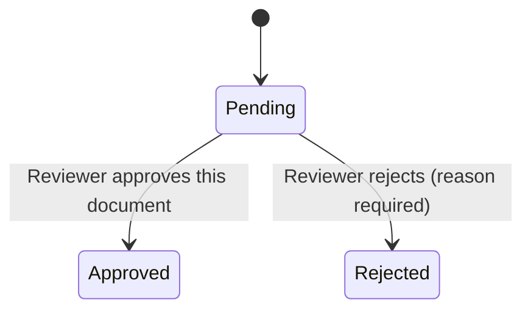

One state machine, two tables (`JobSeekerDocument`, `EmployerDocument`) — same shape. A profile's
overall review (§1) can only reach `Approved` once **every currently-active document** of that
owner is individually `Approved`; one `Rejected` document blocks the profile regardless of the
others.

| Transition | Actor | Side effects |
|---|---|---|
| `Pending → Approved` | Office staff with `jobseekers.review` / `employers.review` | `ReviewedBy`/`ReviewedAt` stamped |
| `Pending → Rejected` | Same | `RejectionReason` required; `Notification` to the owner naming which document and why |

---

## 3. Employer verification — `Employer.VerificationStatus`

Structurally identical to §1 (Draft → Submitted → UnderReview → Approved/Rejected → Suspended ↔
Approved), gated the same way on the 3 required legal documents (`CommercialRegister`, `TaxCard`,
`OwnerNationalId`) instead of the job seeker's 3. Only an `Employer` in `VerificationStatus =
Approved` may proceed to the advertisement workflow (§5).

**Confirmed (RBAC_PERMISSIONS.md §0 item 11), matching §1's rule exactly:** editing the company
profile or re-uploading any `EmployerDocument` after approval **automatically** reverts
`VerificationStatus` from `Approved` back to `UnderReview` — not just a document-level `Pending`
flag with the overall status left untouched. The office is notified and must re-approve before the
Employer can act under `Approved` again (which, per §4, also requires `CooperationStatus ==
Active`).

---

## 4. Employer cooperation — `Employer.CooperationStatus`

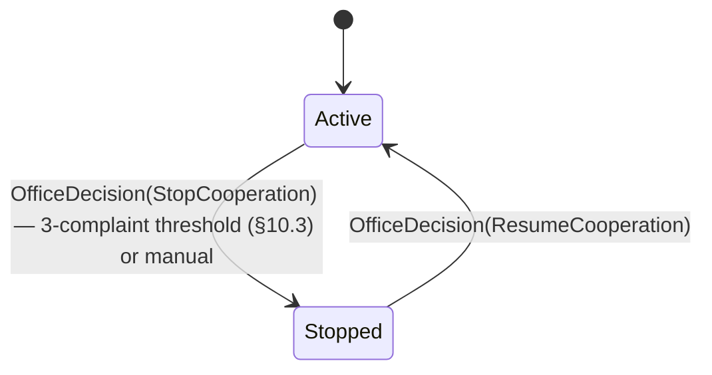

Independent of `VerificationStatus` (BUSINESS_REQUIREMENTS.md §15.1 models them as two fields on
purpose). While `Stopped`: the employer cannot create or submit new advertisements
(`jobadvertisements.create` denied at the service layer regardless of RBAC), but existing
advertisements, applications, payments and reports remain visible — "preserve historical data"
(§11.4).

---

## 5. Job advertisement lifecycle — `JobAdvertisement.Status`

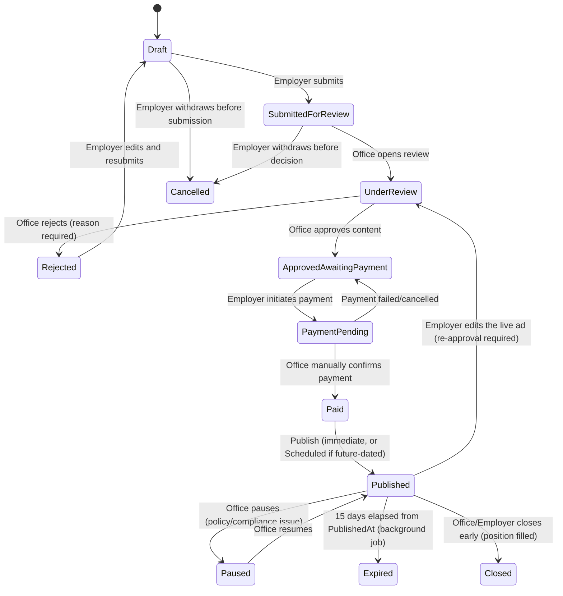

| Transition | Actor / permission | Preconditions | Side effects |
|---|---|---|---|
| `Draft → SubmittedForReview` | `Employer`, `jobadvertisements.submit` | `Employer.VerificationStatus == Approved` **and** `CooperationStatus == Active` | — |
| `SubmittedForReview → UnderReview` | Office, `jobadvertisements.review` | — | — |
| `UnderReview → Rejected` | `jobadvertisements.reject` | Reason required | `Notification` → Employer |
| `UnderReview → ApprovedAwaitingPayment` | `jobadvertisements.approve` | Content complies (no employer contact info, required fields present — §6.2) | `Notification` → Employer with payment instructions |
| `ApprovedAwaitingPayment → PaymentPending → Paid` | Office (`advertisementpayments.record`) | **Confirmed (§0 item 18): manual office confirmation only for v1** — no gateway webhook yet. `RecordedBy` mandatory. | `AdvertisementPayment.PaidAt` stamped |
| `Paid → Published` | System-triggered on payment confirmation | — | `PublishedAt` stamped; `ExpiresAt = PublishedAt + 15 days` computed and stored — **confirmed anchor, §0 item 15** |
| `Published → Expired` | **Background job**, no human actor | `UtcNow >= ExpiresAt` | Advertisement excluded from public search immediately; history (applications, reports) untouched |
| `Published → Paused` / `Paused → Published` | `jobadvertisements.pause` | **Confirmed available (§0 item 16).** | Does not reset or extend the 15-day clock. |
| `Published → UnderReview` | `Employer`, `jobadvertisements.edit` | **Confirmed (§0 item 16): editing a live ad sends it back through office approval.** | `ExpiresAt`/`PublishedAt` **not** reset — only content/approval is re-checked; ad is temporarily excluded from public search while `UnderReview` (same visibility rule as any other non-`Published` state) |
| `Published → Closed` | `jobadvertisements.close` | Early close (position filled) | Removed from public search like `Expired`, but the distinct value preserves "why it left" for reporting. |

**Confirmed, §0 item 15:** office approves content **first**; the Employer pays **after**
approval. The 15-day clock starts at **publish time**, not payment time.

**Confirmed, §0 item 17:** renewal of an `Expired` advertisement always creates a **new**
`JobAdvertisement` row (`RenewedFromAdvertisementId` self-FK, DATABASE_DOCUMENTATION.md §5)
re-entering at `Draft`, pre-filled from the expired one, charged as a **new**
`AdvertisementPayment` — renewal is never a transition on the old row.

---

## 6. Advertisement payment — `AdvertisementPayment.PaymentStatus`

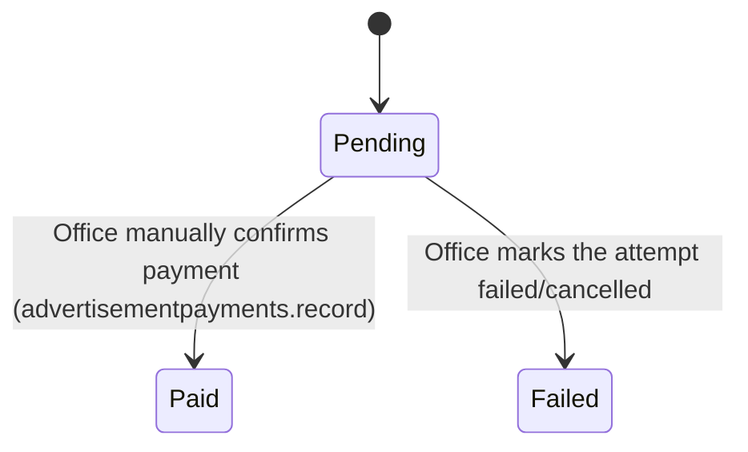

**Confirmed, §0 item 18:** `Manual` is the only `PaymentMethod` in v1 — no payment gateway yet. The
`Refunded` value stays defined on `PaymentStatus` for schema flexibility but is **unused**:
**confirmed, §0 item 20 — no refund policy**, made explicit to the Employer before they pay, so the
transition into `Refunded` has no trigger in v1.

This status is read by exactly one critical check — `applicantdata.viewgated` in
RBAC_PERMISSIONS.md §5 — and by the advertisement-lifecycle transition in §5 above. It must never
be set to `Paid` from client input directly; only from an office action carrying
`advertisementpayments.record` (and, later, a verified payment-gateway callback, when that method
is added).

---

## 7. Job application — dual status tracks

`JobApplication` carries **two** independent status columns, per BUSINESS_REQUIREMENTS.md §8's
explicit warning not to force one field to represent both workflows.

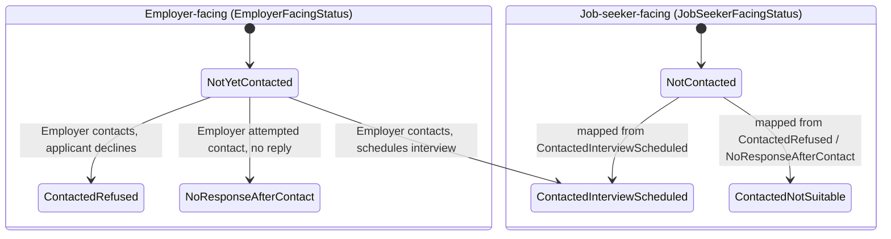

### Mapping table (who updates what, and what the other side then sees)

| `EmployerFacingStatus` (Employer sets, `jobapplications.updateoutcome`) | `JobSeekerFacingStatus` shown to the Job Seeker |
|---|---|
| `NotYetContacted` | `NotContacted` |
| `ContactedInterviewScheduled` | `ContactedInterviewScheduled` |
| `ContactedRefused` | `ContactedNotSuitable` |
| `NoResponseAfterContact` | `ContactedNotSuitable` *(assumption — BUSINESS_REQUIREMENTS.md §24.E.37 leaves "لم يرد بعدها" undefined; mapping it to the same seeker-facing bucket as a refusal is the safe default so the seeker is never shown a false "still pending" state. Revisit once attempt-count rules are confirmed.)* |

Only the Employer mutates `EmployerFacingStatus`; the service recomputes
`JobSeekerFacingStatus` from the table above in the same transaction — **the Job Seeker never
writes either field.** Both changes are recorded on `ApplicationStatusHistory` with a
`StatusDomain` discriminator (DATABASE_DOCUMENTATION.md §6).

**Confirmed (RBAC_PERMISSIONS.md §0 item 9):** once `AdvertisementPayment.PaymentStatus == Paid`,
the Employer's contact with the applicant happens **directly** (their revealed phone number), not
relayed message-by-message through the office — the office still sees every
`EmployerFacingStatus` update and `ApplicationStatusHistory` row, it just isn't the communication
channel itself.

### Withdrawal & re-application (confirmed, §0 item 14)

A third, Job-Seeker-only-triggered transition, orthogonal to the two status tracks above:

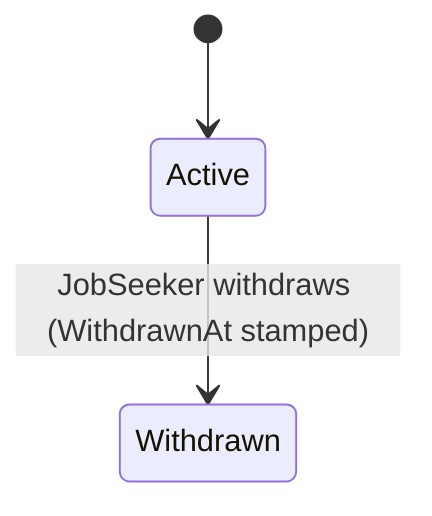

- The Job Seeker may withdraw an `Active` (non-withdrawn) application at any time.
- `Withdrawn` is terminal for that specific `JobApplication` row — it is not reactivated.
- The Job Seeker may submit a **new** `JobApplication` row for the same advertisement afterward;
  the uniqueness rule only ever blocks a second *active* application
  (DATABASE_DOCUMENTATION.md §6's filtered unique index).
- Withdrawing does not delete or hide the row from the Employer/office — it remains visible in
  history, flagged `Withdrawn`, consistent with the platform's "preserve history" convention.

---

## 8. Interview — `Interview.Status`

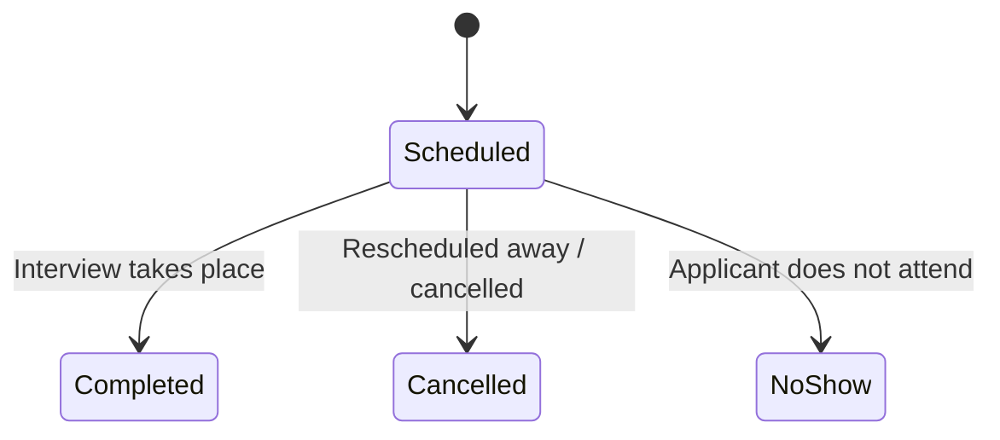

`Completed` or `NoShow` is the trigger that makes the application eligible for an `InterviewReport`
(§9). **Confirmed (RBAC_PERMISSIONS.md §0 item 21): the Employer** schedules and records the
interview, consistent with direct post-payment contact (§7).

---

## 9. Reports

### 9.1 First report (`InterviewReport`) and second report (`HiringFollowUpReport`)

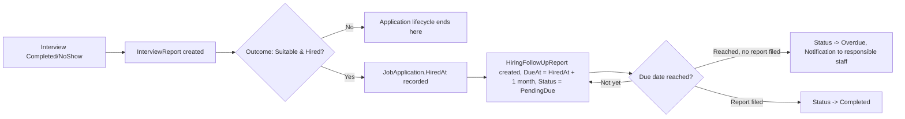

**Confirmed (RBAC_PERMISSIONS.md §0 item 21):** the Employer writes `InterviewReport`; the office
writes `HiringFollowUpReport`, following up with both the Employer and the Job Seeker. The
one-month follow-up is **mandatory for every hire** — an unfiled report past `DueAt` becomes
`Overdue` and notifies the responsible staff, with no stronger enforcement than that notification
(confirmed; there is no automatic penalty beyond the alert). Whether the *first* report is a hard
gate before an application can be marked "hired" was not asked directly — this flow still treats it
as **not** a hard gate (a missing `InterviewReport` shows as a data-quality gap on the office
dashboard, not a blocked transition); flag this explicitly if the product owner wants it enforced
more strictly.

### 9.2 Per-applicant evaluation (`ApplicantEvaluationReport`)

Not a state machine — a single write, `Outcome ∈ {Suitable, NotSuitable, DidNotAttend,
RefusedJob}`, created once per `JobApplication` by the Employer (`applicantevaluationreports.create`)
and visible to the owning office thereafter. An update **replaces** the existing row's `Outcome`/
`Notes` (keep prior values in `AuditLog`, not a new business row) rather than creating a second
evaluation per application.

---

## 10. Complaints, suggestions & the 3-strike enforcement workflow

### 10.1 Complaint record — `Complaint.Status` / `Complaint.ValidityDecision`

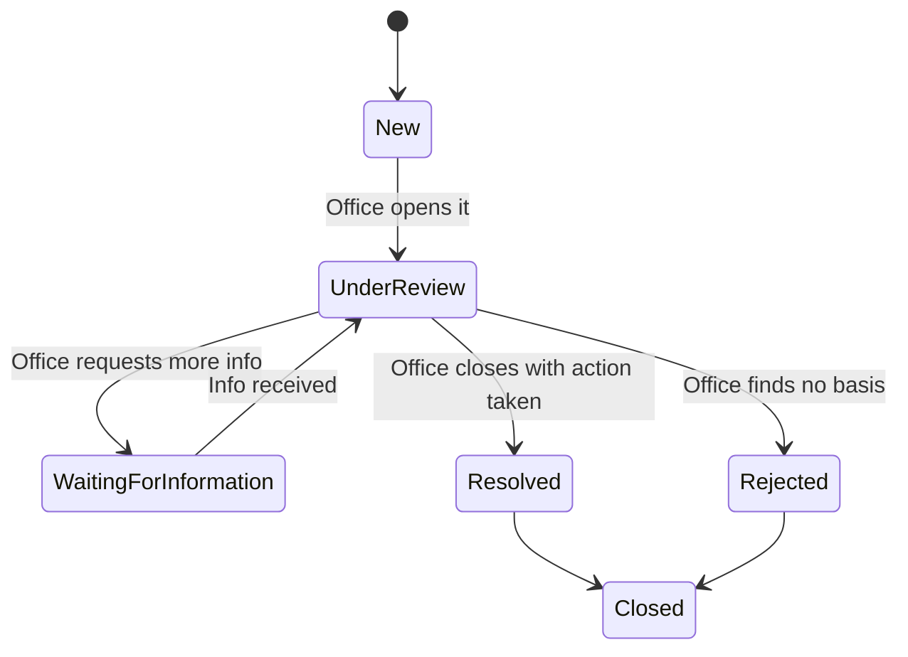

`ValidityDecision` (`Pending` → `Valid` / `Invalid`) is set **alongside** this status, typically
when leaving `UnderReview`, and is the field the 3-strike counter reads — see §10.3.

### 10.2 Suggestion record — `Suggestion.Status`

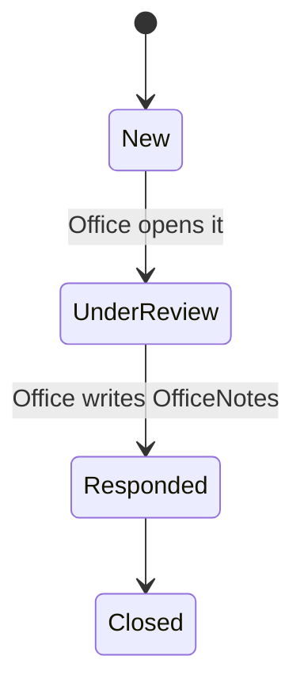

### 10.3 Three-strike enforcement (BUSINESS_REQUIREMENTS.md §11.3/§11.4, §11.5)

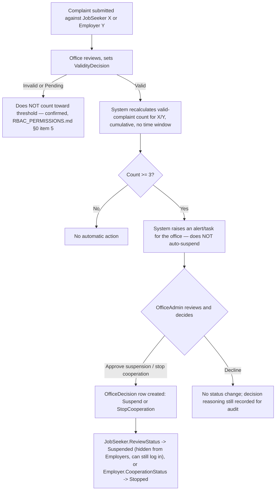

**This is acceptance-critical** (BUSINESS_REQUIREMENTS.md §18.24/§18.25, §20.4): no automatic
punitive action fires purely from the count reaching 3. The count only ever produces an **alert**;
only an `OfficeAdmin` (confirmed, RBAC_PERMISSIONS.md §0 item 8 — not grantable to `OfficeStaff`)
can act, and that action is always an auditable `OfficeDecision` row with a reason — never a bare
status flip.

**Confirmed, RBAC_PERMISSIONS.md §0 items 5–7** (BUSINESS_REQUIREMENTS.md §24.G.46/§48/§51):
- Only **office-confirmed-`Valid`** complaints count — `Pending` and `Invalid` ones never do.
- The count is a **running, cumulative total with no expiry/reset window** — for both Job Seekers
  and companies.
- A suspended Job Seeker's profile becomes **hidden from Employers**; they can still log in and
  view their own account/status — suspension is not a login block.

Still genuinely open (BUSINESS_REQUIREMENTS.md §24.G.47/§49/§52/§53): the precise phrase "three
*in a row*" vs. simply "three valid complaints" (modeled here as the latter — a plain count, not a
strict unbroken sequence check), whether stopping cooperation with a company is meant to be
temporary or permanent, and whether a suspended Job Seeker or blocked company has a formal appeal
path. Flag these explicitly before the enforcement job ships if the product owner wants a stricter
reading.

---

## 11. End-to-end process diagrams (BUSINESS_REQUIREMENTS.md §22 checklist)

The sections above are the authoritative per-entity state machines. These sequence views stitch
them together end-to-end, matching the 10 diagrams BUSINESS_REQUIREMENTS.md §22 asks for before
implementation.

### 11.1 Job Seeker registration → approval

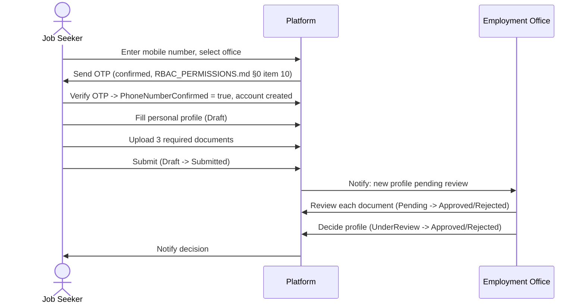

### 11.2 Employer registration → approval

Same shape as 11.1, substituting `Employer` + its 3 legal documents (§3).

### 11.3 Advertisement creation → review → payment → publication → expiry

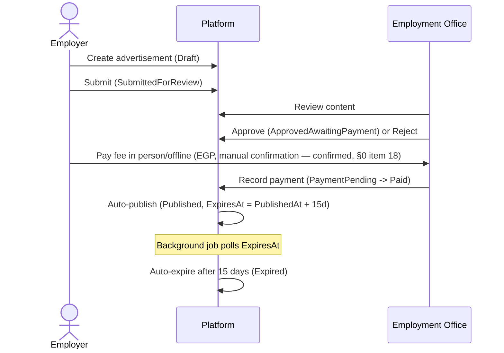

### 11.4 Job Seeker browses → applies → status updates

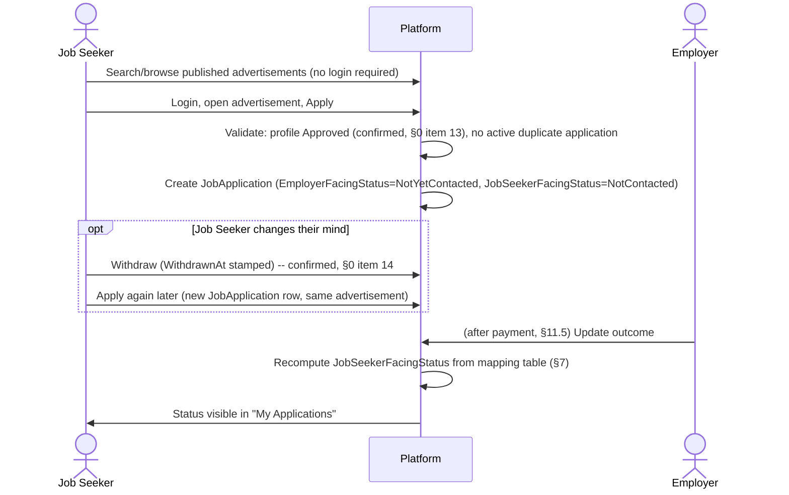

### 11.5 Employer paid access → applicant data → communication outcome → interview

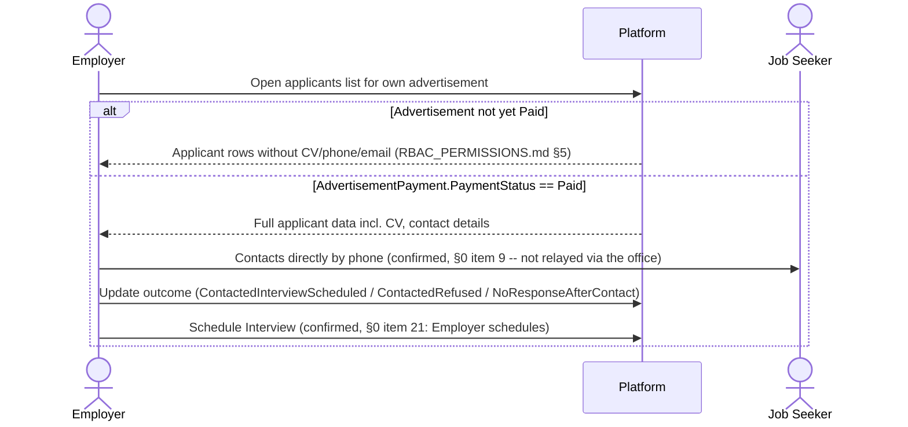

### 11.6 Interview → first report → hiring decision → one-month follow-up

Already shown as a flowchart in §9.1.

### 11.7 Complaint submission → investigation → threshold → decision

Already shown as a flowchart in §10.3.

### 11.8 Suggestion submission → office review

Already shown as a state diagram in §10.2.

### 11.9 Super Admin creates office → assigns admin → office operates independently

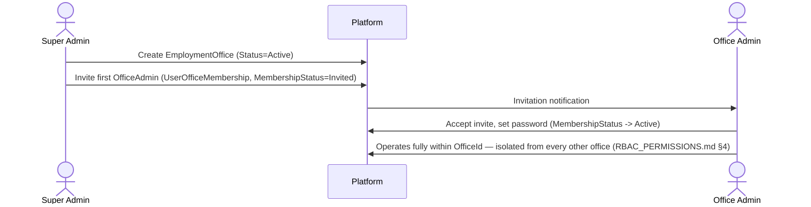

### 11.10 Tenant authorization flow for every protected request

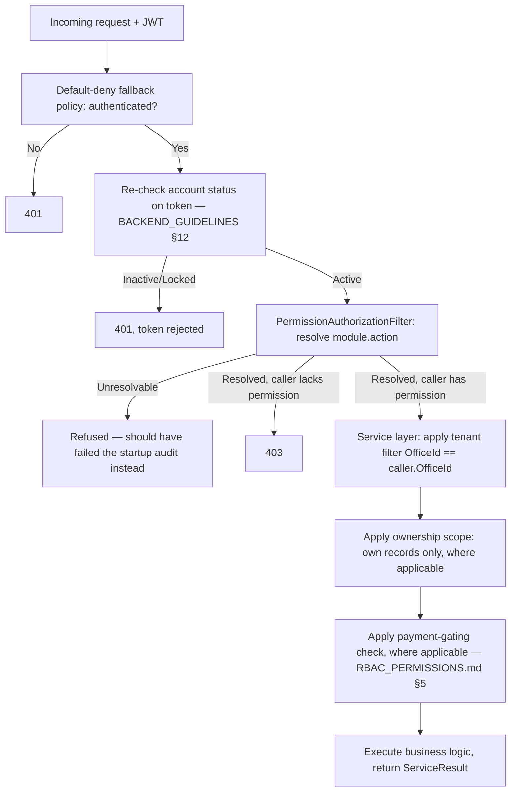

---

*Any change to a status enum's allowed values or transitions must update this document and
DATABASE_DOCUMENTATION.md §3–§7 in the same change — a state machine that only exists in code is a
state machine nobody can review.*
